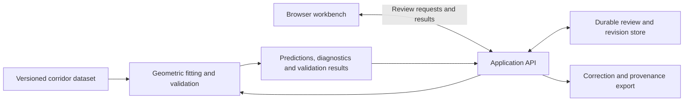

# Cateniq — Project Concept

Status: initial concept, before project bootstrap and detailed planning.  
Date: 22 October 2026.

> A spatial QA workbench for reviewing, correcting and validating automatically extracted electricity-network models.

This document establishes the project's motivation, product idea, technical direction and portfolio purpose. It describes intended behaviour, not implemented capabilities. Milestones, delivery estimates, behavioural contracts and detailed implementation decisions belong to the subsequent planning work.

## Motivation

Electricity-network models can be constructed from spatial observations such as LiDAR point clouds: collections of measured points in three-dimensional space. Algorithms turn those observations into structured assets such as poles and conductor spans—the sections of overhead wire between adjacent supports. Incomplete observations, noise and ambiguous geometry can produce incorrect models even when processing finishes successfully.

People need tools to inspect the evidence, understand what went wrong, correct the result and establish whether it is ready for downstream use. That creates a software engineering problem spanning scientific computation, interactive graphics, workflow reliability and data provenance.

Cateniq explores that problem through a small, complete application. Its purpose is to demonstrate that an engineer can turn imperfect algorithmic output into a usable, recoverable review workflow, with clear evidence for the resulting model's quality.

## Product idea and intended user

The intended user is a delivery or model-review engineer checking an automatically reconstructed powerline corridor. They need to resolve questionable geometry without modifying code or asking a developer to rerun processing manually.

The workbench combines a diagnostic queue, a 3D evidence view, a focused correction tool and validation results. The user can move from an issue to the relevant observations, edit the model, compare results and save a traceable correction.

The initial scenario is deliberately narrow:

> A conductor span has an incorrectly fitted endpoint. The reviewer inspects its supporting point cloud, corrects the endpoint, reruns the fit, compares validation results and saves the correction.

The application should explain both successful results and cases where the available evidence is insufficient. A user edit is a proposed correction; it does not automatically become verified ground truth or establish engineering safety.

## What the demonstration will show

The main demonstration follows one review journey:

1. **Load evidence.** Open a reproducible synthetic corridor containing poles, conductor points and a known extraction challenge.
2. **Inspect computed diagnostics.** Run geometric fitting and validation, then select a questionable span from the resulting queue.
3. **Understand the issue.** View the observations alongside the predicted geometry and the measurements supporting the diagnostic.
4. **Make a reversible correction.** Adjust the endpoint using a constrained spatial editing tool, with undo and redo.
5. **Check the result.** Rerun fitting and validation while preserving the human correction, and compare the resulting geometry and quality measurements with the original prediction.
6. **Save and revisit.** Persist the correction and its source revision, reopen the result and export a provenance record.

Supporting demonstrations should show a recoverable processing failure, a stale edit being rejected without losing the user's proposed work, and measured interaction performance. These strengthen the same review journey rather than introducing separate products.

The synthetic dataset and any injected prediction errors will be labelled explicitly. Fitting and diagnostics will perform real computation; the application will not present a scripted issue list as algorithmic detection. Synthetic reference geometry can support independent evaluation, but must remain separate from the observations available to the fitting algorithm.

## High-level delivery approach

Development will proceed through progressively stronger versions of the same workflow:

- **Establish the interaction:** demonstrate that inspecting and correcting one span is understandable and usable in the browser.
- **Complete the review journey:** connect real fitting, validation, reversible editing and durable correction records.
- **Demonstrate reliability:** exercise reruns, recovery, revision conflicts and preservation of human work.
- **Build evidence:** measure correctness and performance across varied datasets, document limitations and prepare a repeatable demo.

The first version can recompute the whole small corridor. Incremental processing is a later optimisation, justified by measurements and checked against full recomputation. Additional correction tools or real-world datasets should follow only when the initial journey is convincing.

This is a direction of travel, not a milestone schedule or task backlog.

## High-level architecture

Cateniq will be a single repository containing a browser workbench, a Python service, geometric computation and reproducible datasets. Logical boundaries matter more than deploying many services.

### Browser workbench

The client owns navigation, spatial inspection, selection, edit previews and local undo/redo. It keeps expensive computation away from the rendering path and clearly distinguishes unsaved edits, pending calculations and authoritative saved results.

### Application service

The service coordinates processing and review operations, reports actionable failures, checks revisions and persists accepted changes. It binds results to the input and model revisions that produced them so an older calculation cannot silently replace a newer result.

### Geometric computation

A separate logical module fits conductor geometry and computes diagnostic measurements against point-cloud observations. It must support repeatable evaluation, explicit units and coordinate conventions, and useful outcomes when a fit fails or is poorly supported.

Catenary geometry is a fitting model for hanging conductors. Its use does not imply a validated thermal-mechanical simulator or a certified clearance assessment.

### Review state and provenance

The data model will distinguish:

- Immutable source observations and dataset identity.
- Original algorithm predictions, including algorithm version and parameters.
- Human corrections or constraints, linked to their base revision.
- Derived model and validation results for the relevant revision.

Rerunning an algorithm must preserve the reviewer's work or explicitly surface an incompatibility. Corrections must not disappear through silent overwrites. Saving an edit, passing geometric checks and a reviewer accepting the result are distinct events.

Exports will capture enough context to understand and reproduce a correction. They demonstrate training/evaluation data capture, not a complete active-learning system.

## Proposed technology stack

These are starting choices to confirm during bootstrap, rather than locked implementation decisions.

| Area | Proposed choice | Purpose |
| --- | --- | --- |
| Browser application | TypeScript, React, Vite | Typed application state and a focused browser workbench |
| 3D rendering | Three.js / WebGL | Point clouds, predicted geometry, selection and edit previews |
| Application API | Python, FastAPI, REST | Review operations, processing coordination and typed request validation |
| Geometry and numerical work | NumPy, SciPy | Array processing, fitting and spatial queries |
| Persistence | SQLite initially | Durable revisions and review records for a small demonstration deployment |
| Data fixtures | Seeded Python generator and versioned dataset manifests | Reproducible observations, reference geometry and failure cases |
| Verification | Python tests and browser interaction tests, with performance measurements | Numerical behaviour, state transitions and the complete user journey |

Point-cloud data should be handled separately from ordinary review metadata so larger datasets do not require embedding every point in routine API responses. The exact asset format, execution model for background work and deployment arrangement will be decided during planning.

The stack is chosen to support delivery and transferable engineering skills. It is not intended to reproduce Neara's internal implementation. GraphQL, additional infrastructure and alternative languages should be introduced only for a concrete need.

## Alignment with the Neara role

The target is Neara's [Senior Software Engineer — Digitisation role](https://jobs.ashbyhq.com/neara/357478aa-cfae-42c0-b2b9-b90dd9be1e38), reviewed on 22 October 2026. The role focuses on making digital-twin construction self-service and improving the interface between algorithms and delivery teams.

| Role emphasis | Evidence Cateniq intends to provide |
| --- | --- |
| Users complete processing and recover without developer intervention | Visible processing state, actionable diagnostics and a recoverable failure demonstration |
| Users find and correct inaccurate outputs | A computed diagnostic linked to evidence, a correction tool and before/after validation |
| Multiple people work without conflicting changes | Revision checks that prevent silent overwrites; full simultaneous editing is beyond the initial scope |
| Human corrections feed training and evaluation | Versioned correction export with source and prediction provenance |
| Work is measurable and repeatable | Consistent review units and measured processing time, correction time and quality outcomes |
| Expert tools load and respond quickly | Measurements of loading, frame times, selection, editing and recalculation on documented hardware and datasets |
| Product ownership extends to user adoption | A usable demonstration, onboarding guidance and feedback-driven refinement where reviewers are available |

Neara describes a Dart client, C++/Rust computation engines and a Java backend, while listing TypeScript, WebGL and Python among relevant experience. Cateniq targets the role's engineering problems rather than claiming an exact stack match.

The project will demonstrate a bounded portion of this work. It will not establish experience operating Neara-scale datasets, forecasting global delivery throughput or rolling software out to distributed production teams.

## Place in an energy software engineering portfolio

Cateniq complements NEMLab and Voltix by adding spatial computation and expert-facing interactive software to the existing market and edge-control projects.

| Project | Domain focus | Principal engineering evidence |
| --- | --- | --- |
| NEMLab | Electricity-market data, battery simulation and optimisation | Reproducible data and results, backend workflows, numerical optimisation and browser applications |
| Voltix | Simulated battery-site control and telemetry | Protocol integration, supervisory control, dispatch expiry, failure handling and durable telemetry |
| Cateniq | Spatial electricity-network model review | Dense 3D interaction, geometric computation, reversible editing, model validation and human correction workflows |

Together, the projects support a coherent portfolio narrative:

> I build energy software across market analysis, field control and infrastructure modelling, with particular attention to correctness, failure behaviour and usable engineering tools.

These are complementary demonstrations, not a complete implementation of the electricity system. They do not need to communicate with each other to make that narrative credible, and integration is not a requirement for Cateniq.

Cateniq's closest role fit is spatial and digitisation tooling. Its broader value comes from transferable skills: building stateful applications, integrating numerical algorithms, preserving user work, managing asynchronous results and making imperfect automated outputs reviewable. For market, VPP or edge roles, NEMLab or Voltix may remain the stronger lead project.

## Scope boundaries

The initial project will not include:

- Dynamic operating envelopes, feeder hosting-capacity calculations or power-flow analysis.
- Thermal, wind or structural simulation presented as engineering-grade physics.
- Training a LiDAR classifier or implementing a full active-learning loop.
- A general-purpose CAD editor, a large catalogue of editing tools or full real-time collaborative editing.
- Claims of production-scale utility deployment, certified safety assessments or guaranteed role suitability.

A corrected model changes the representation and its estimated properties; it does not physically repair infrastructure or create new network capacity.

## What would make the project successful

Cateniq succeeds when another person can understand an issue, inspect its evidence, make a correction and verify what was saved without assistance from the developer. The implementation should make failures and uncertainty visible, preserve human work across reruns and conflicts, and provide reproducible evidence for its correctness and performance claims.

The portfolio deliverable is a finished review workflow with a repeatable demonstration and clear technical explanations. Detailed contracts, acceptance criteria, benchmarks and milestones will be established in the next planning stage.

## Background

This concept consolidates the initial discussion and subsequent scope reviews:

- [Original Gemini discussion](initial-discussion/00%20gemini.md)
- [Initial Codex assessment](initial-discussion/01%20codex.md)
- [Revised Gemini proposal](initial-discussion/02%20gemini.md)
- [Further Codex scope review](initial-discussion/03%20codex.md)
- [Latest supplied discussion](initial-discussion/04%20gemini.md)

The external job description is time-sensitive. Future application preparation should recheck the live role rather than assuming its wording is unchanged.
