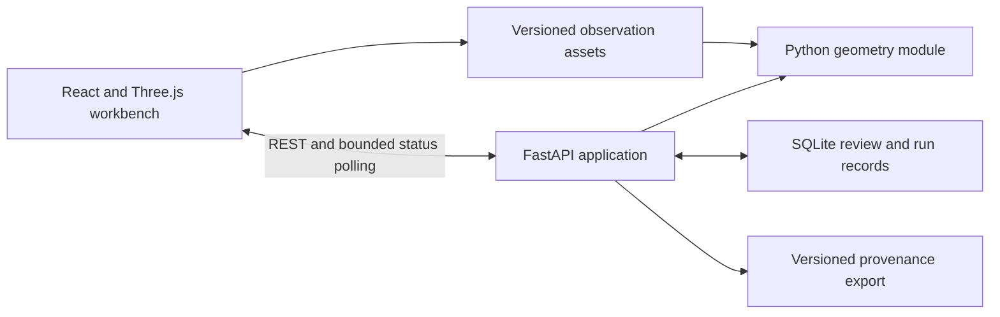

# Cateniq architecture

Date: 2026-10-22

Status: M1 workspace, fixtures, reference geometry and endpoint prototype implemented; existing checks reproduced. Prior M1 evidence gaps and M2 review findings are resolved with regression coverage (see [M2 review](evidence/m2-exit-review.md)); durable review remains M3 design. See [decision 002](decisions/002-scope-and-stack.md) and the [implementation gates](blockers.md).

## Scope and boundaries

Build one local review workbench for a synthetic electricity corridor. A user inspects computed evidence for an incorrect conductor endpoint, applies a reversible correction, validates the result and saves a traceable review. The [concept](../project-concept.md) owns motivation; the [roadmap](roadmap.md) owns delivery sequence.

Initial support is one conductor per span in a declared vertical plane, known support identities, static source observations, and one endpoint correction tool. Supplied labels and support identities are inputs, not claims of implemented classification or pole extraction. Non-coplanar and poorly supported cases must be rejected or marked unsupported rather than silently forced into this model.

No DOE, thermal/wind solver, active-learning training loop, general CAD editor, large-scale distributed processing or public multi-tenant service is planned. A model correction changes the representation, not physical infrastructure.

## Components



- **Workbench:** React owns workflow state; Three.js owns scene objects and interaction. Use typed arrays and shared point buffers, not a component per point. Scene resources must be disposed when switching datasets. Local edits and command history remain distinct from server revisions.
- **Application layer:** validates requests, coordinates bounded computation, checks input/review revisions and returns explicit state/reason codes. The browser never decides whether a save is authoritative.
- **Geometry module:** numerical code independent of HTTP, persistence and rendering; consumes observations, supplied topology and explicit constraints; produces fitted geometry, metrics and failure reasons.
- **Store:** SQLite holds review revisions, commands accepted as corrections, run attempts and result metadata. Immutable observation assets are separate files named through manifests. Store content hashes and schema versions so results cannot be attached to the wrong dataset.
- **Export:** a schema-versioned snapshot of observations' identity, predictions, corrections, validation and review acceptance. It references source data; it need not duplicate every point.

Proposed workspace layout (directories created when they contain implementation):

```text
apps/web/                 TypeScript browser application
backend/src/cateniq/      Python geometry, application and persistence modules
backend/tests/           Numerical and service tests
contracts/               Versioned schemas and API contract artifacts
fixtures/                Small immutable manifests and reference fixtures
scripts/                 Dataset generation and repeatable development/demo tools
docs/project/            Canonical project records
```

One repository, one Python package and one frontend application are sufficient. Do not split logical modules into services without a demonstrated need.

## Stack and development direction

| Component | Initial selection | Verification before relying on it |
| --- | --- | --- |
| UI | TypeScript, React, Vite; plain CSS | Locked production build and browser smoke |
| Rendering | Three.js directly behind a small scene adapter | Selection, coordinate conversion and disposal prototype |
| API | Python, FastAPI, REST, OpenAPI-generated TypeScript types | Request validation and generated-contract compatibility |
| Numerics | NumPy, SciPy | Independent fixtures, convergence and unsupported-case checks |
| Storage | Python SQLite adapter with explicit transactions and schema versioning | Conditional writes, restart recovery and failure tests |
| Tooling | npm lockfile; uv lockfile; Python formatter/type checks and TS checks | Compatible exact versions and clean-environment setup |
| Tests | pytest and Playwright | Real service/browser journey alongside deterministic unit tests |

Versions, formatter configurations and exact commands are a CAT-003 deliverable, not claims in this plan. No GraphQL, ORM, Redis or distributed queue is needed for the initial scope.

## Data and numerical boundary

Use a local Cartesian coordinate system: metres, right-handed, Z up; fixture manifests record origin, axes and units. The numerical domain uses double precision. Rendering may use a local offset and float buffers, but conversions must be explicit and round-trip tested. Geographic CRS transformation is outside the first dataset profile.

A dataset identifies observations, point IDs, supplied labels/topology, generation seed/version and hashes. Synthetic ground truth is a separate evaluation artifact and never an input to the production fitter or diagnostic thresholds. A declared injected prediction error can provide a repeatable review scenario; it must not be described as an error naturally produced by the extraction algorithm.

The fitting profile, residual definition, outlier policy, minimum evidence and numerical tolerances must be frozen in CAT-004 before implementation. A catenary fit provides geometric evidence only. A low fit residual cannot alone certify a correct attachment or safe clearance.

## Correction and result identity

Keep four things separate: immutable source observations, original prediction, human constraints, and derived results. A review revision captures a coherent correction set. Runs reference an immutable snapshot of that revision, dataset hash, algorithm version and parameters.

Save uses an atomic conditional update against the caller's base revision. A stale write receives a conflict and current revision metadata; it does not discard the local proposal. Use stable operation IDs so a lost response can be retried without a second revision. Changed content under the same operation ID is rejected. SQLite is authoritative even when clients share one local machine.

Derived results can be stored for their original revision, but only results matching the current review revision can be presented as current. The reviewer accepts a specific validated revision; any later edit invalidates that acceptance. Undo after a save creates a new revision instead of deleting history. See [review lifecycle](features/review-lifecycle.md).

## Processing and recovery

Use one API process with at most one active numerical run in a separate bounded execution context; the exact process/timeout mechanism is verified in CAT-009. CPU work must not block request handling. Persist a run before executing it; keep input snapshots immutable and all publication writes in the API/store owner.

Logical stages are load/validate inputs, fit, and validate outputs. Record pending/running/succeeded/failed/interrupted states, stage diagnostics and durations. A restart marks abandoned active attempts interrupted. The user can retry from durable inputs; the initial version recomputes the small corridor instead of resuming arbitrary intermediate memory state.

Retry is a new traceable attempt against an explicit revision and never erases human constraints. Bound queue size, data size, execution time and polling. Exact limits are established before the relevant acceptance tests. Full corridor recomputation is the correctness baseline; incremental dependency invalidation is deferred.

## Deployment and access boundary

Develop and demonstrate locally with loopback binding. The packaged browser and API should use the same origin; development uses an explicit proxy. Two browser sessions are sufficient to demonstrate revision conflicts; they do not establish multi-user identity or authorisation.

No arbitrary dataset uploads, public mutable endpoint or production authentication is part of the initial deployment. A later public demo requires its own hosting and access design. Packaging must document state location, safe reset and cleanup limited to project-created resources. Preserve existing data on schema mismatch or corruption; fail clearly instead of silently creating an empty replacement.

## Observability and evidence

Expose dataset/revision/run identity, stage and reason codes, processing duration and validation measurements. Record frame-time distributions, edit/selection latency, load time, memory observations and recalculation latency for declared workloads. Machine processing time and observed review-session time are different metrics; neither is automatically a productivity forecast.

Do not log full point arrays or private configuration. Evidence must distinguish synthetic fixtures, local browser results, real-process integration, hosted CI and deployment. Architecture completion is judged by the [verification matrix](features/verification.md), not by the existence of this document.
